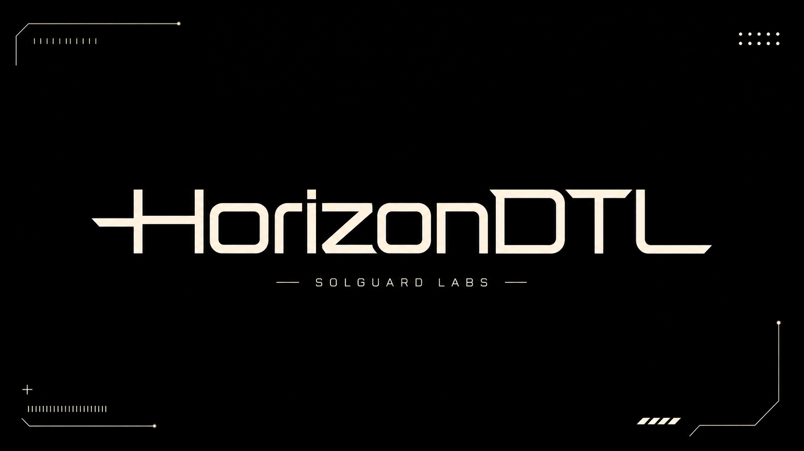
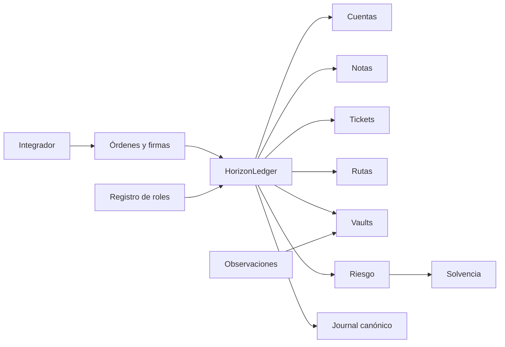
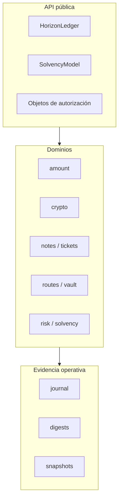
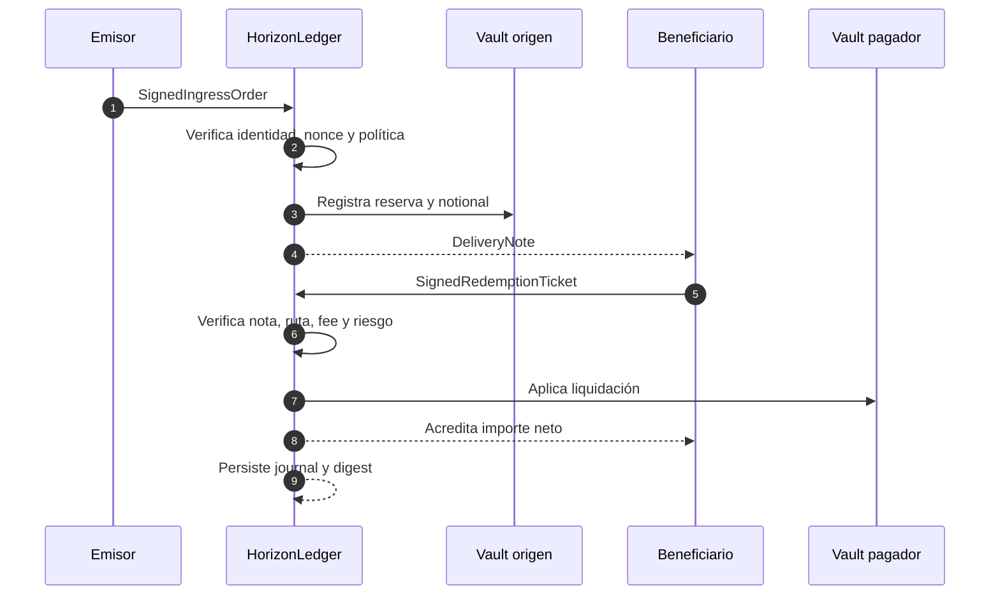
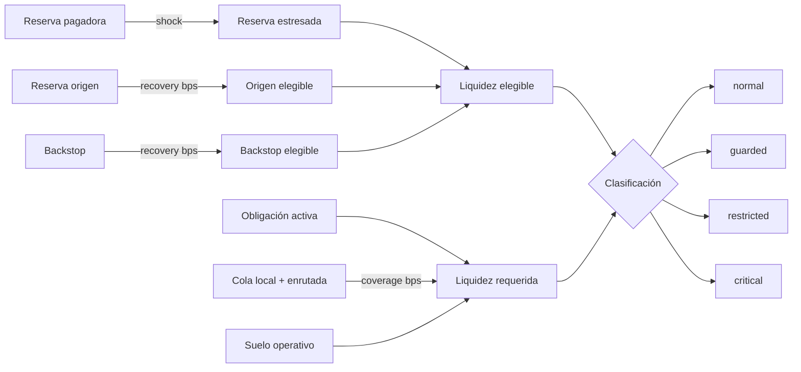
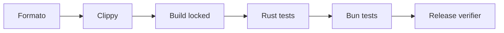

# HorizonDTL



HorizonDTL es un núcleo de liquidación distribuida escrito en Rust. Coordina cuentas
firmadas, vaults de liquidez, notas de entrega, tickets de redención y rutas entre dominios
contables. El crate prioriza aritmética entera, transiciones deterministas y trazabilidad
mediante un journal canónico.

La versión `1.0.0` incorpora un modelo de solvencia por escenarios y un cliente JavaScript
basado en `BigInt` para que operadores e integradores calculen la misma proyección sin perder
precisión.

## Capacidades

- identidades Ed25519 y autorizaciones ligadas a `network_id`;
- activos con precisión explícita y fees expresados en basis points;
- vaults con reservas, notional comprometido e índices observables;
- rutas con límites mínimo, máximo, tolerancia y ventana temporal;
- notas de entrega y tickets de redención con nonces independientes;
- límites operativos, snapshots de riesgo y bandas de solvencia;
- journal canónico con digest posterior a cada transición económica;
- cliente JavaScript inmutable para proyecciones previas a la ejecución.

## Arquitectura



El crate expone una fachada estable desde `src/lib.rs`; cada dominio mantiene sus tipos,
reglas y estado en un módulo separado. Los consumidores no necesitan acceder a estructuras
internas del ledger.



## Flujo de liquidación



Cada orden se valida antes de mutar el estado. El journal se añade al final de la transición y
permite reconciliar el suministro registrado con saldos de cuentas, reservas y fees.

## Modelo de solvencia

La proyección combina reserva pagadora bajo estrés, recuperación atribuible al origen,
capacidad de backstop y obligaciones activas o en cola. Todos los cálculos redondean hacia
abajo y fallan de forma cerrada ante un desbordamiento.



La concentración de la mayor ruta se evalúa además de la cobertura. Una proyección puede
tener capital suficiente y, aun así, quedar restringida por concentración.

## Inicio rápido

Requisitos:

- Rust `1.96` o posterior compatible con edición 2024;
- Bun `1.3` o posterior;
- Python `3.11` o posterior para verificaciones del release.

```bash
bun install --frozen-lockfile
bun run build
bun run test:all
bun run ci
```

### Configuración del ledger

```rust
use horizon_dtl::{Amount, AssetConfig, Bps, HorizonLedger, RiskLimits};

let mut ledger = HorizonLedger::new(72_901);
let asset = AssetConfig::new("HUSD", 6, Bps::new(80)?)?;
ledger.register_asset(asset)?;
ledger.set_risk_limits(RiskLimits::new(
    500,
    Amount::new(50_000_000_000)?,
    Bps::new(100)?,
    Amount::new(5_000_000_000)?,
)?)?;
# Ok::<(), horizon_dtl::HorizonError>(())
```

### Proyección previa

```rust
use horizon_dtl::{Amount, Bps, SolvencyInput, SolvencyModel, SolvencyPolicy};

let policy = SolvencyPolicy::new(
    Bps::new(1_000)?,
    Bps::new(8_000)?,
    Bps::new(5_000)?,
    Bps::new(8_000)?,
    Bps::new(1_000)?,
    Bps::new(5_000)?,
    Amount::new(100_000_000)?,
)?;
let projection = SolvencyModel::evaluate(
    policy,
    SolvencyInput::new(
        Amount::new(9_000_000_000)?,
        Amount::new(4_000_000_000)?,
        Amount::new(7_000_000_000)?,
        Amount::new(900_000_000)?,
        Amount::new(600_000_000)?,
        Amount::new(2_000_000_000)?,
        Amount::new(2_500_000_000)?,
    ),
)?;
assert!(projection.capital_shortfall.is_zero());
# Ok::<(), horizon_dtl::HorizonError>(())
```

### Cliente JavaScript

```javascript
const { projectSolvency } = require("./client/horizon");

const result = projectSolvency(
    {
        reserveShockBps: 1000,
        sourceRecoveryBps: 8000,
        backstopRecoveryBps: 5000,
        queuedCoverageBps: 8000,
        targetBufferBps: 1000,
        maxRouteConcentrationBps: 5000,
        reserveFloor: "100000000",
    },
    {
        payoutReserve: "9000000000",
        sourceReserve: "4000000000",
        liveRoutedLiability: "7000000000",
        queuedLocalLiability: "900000000",
        queuedRoutedLiability: "600000000",
        backstopCapacity: "2000000000",
        largestRouteLiability: "2500000000",
    },
);
console.log(result.band, result.coverageBps);
```

## Verificación



| Comando                  | Alcance                                           |
| ------------------------ | ------------------------------------------------- |
| `bun run check`          | Rustfmt y Clippy                                  |
| `bun run build`          | Todos los targets con `Cargo.lock`                |
| `bun run test:rust`      | Flujos, políticas y proyecciones                  |
| `bun run test:node`      | Cliente, metadata y calidad externa               |
| `bun run verify:release` | Estructura, versiones, banner y contratos fijados |
| `bun run ci`             | Cadena local completa                             |

## Estructura

```text
client/                 cliente operativo JavaScript
docs/                   arquitectura, economía, riesgo y operación
scripts/                CI, tests y verificación de release
src/                    dominios Rust
tests/                  pruebas de integración Rust y Bun
.github/workflows/      validación continua e integridad de publicación
.vscode/                tareas, formato y depuración
```

La documentación técnica comienza en [`docs/arquitectura.md`](./docs/arquitectura.md).
Las expectativas de seguridad están en [`SECURITY.md`](./SECURITY.md) y el historial estable
en [`CHANGELOG.md`](./CHANGELOG.md).

## Compatibilidad del release

`v1.0.0` define el contrato público inicial. `main`, `production` y el tag estable deben
resolver al mismo commit; `RELEASE.json` es la fuente legible por herramientas para validar
nombre, versión, rama y toolchains.

Licencia: MIT.
