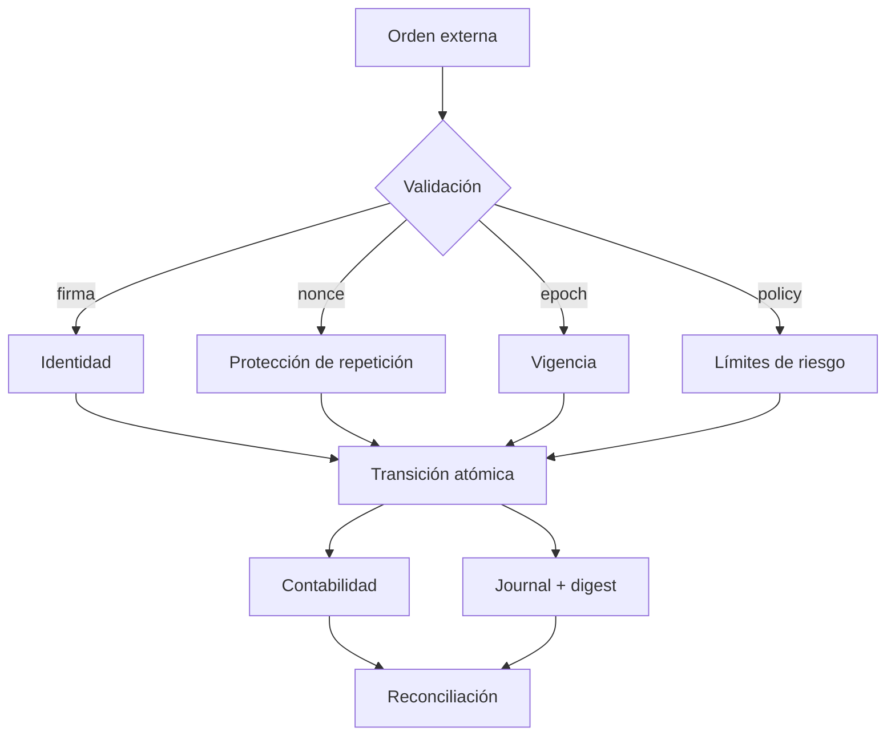
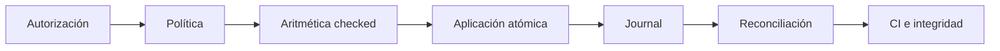
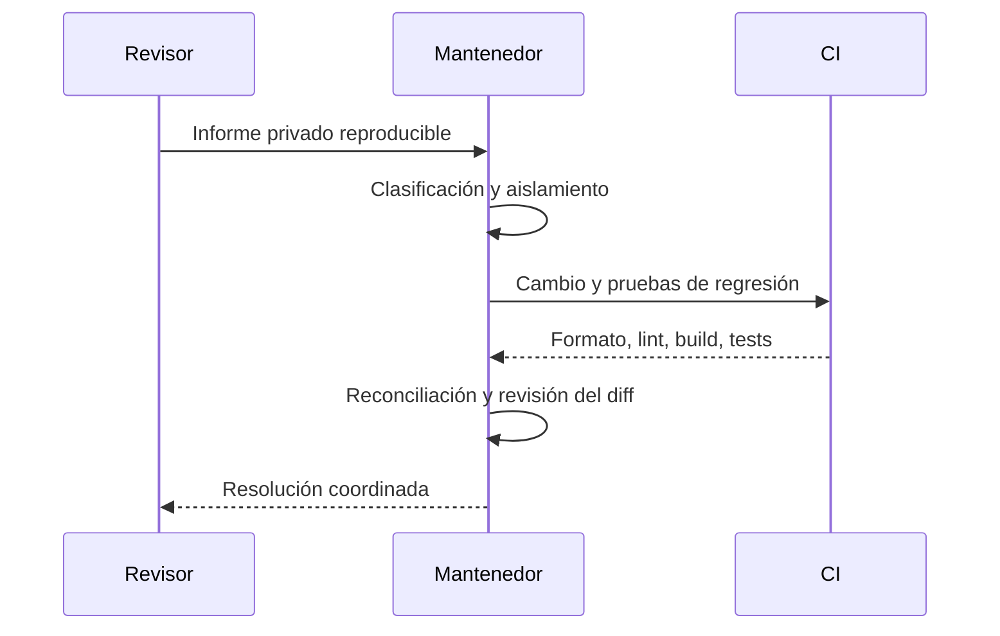

# Seguridad de HorizonDTL

HorizonDTL aplica autorización criptográfica, aritmética comprobada, límites de riesgo y
reconciliación contable en cada transición. Este documento define las propiedades que deben
preservar el núcleo, sus integraciones y el proceso de publicación.

## Límites de confianza

Los bytes autorizados se construyen mediante serialización canónica. Las firmas se vinculan
al identificador de red, al firmante esperado, al nonce y al objeto económico concreto.

## Invariantes

1. El suministro registrado por activo coincide con cuentas, reservas y fees acumulados.
2. Un ticket procesado no vuelve a producir una transición.
3. Los nonces avanzan únicamente después de una operación aceptada.
4. Una nota no cambia de beneficiario, activo, origen ni digest tras su emisión.
5. Una ruta solo admite importes y epochs incluidos en su política.
6. Los fees del relayer permanecen bajo el límite configurado.
7. El saldo proyectado del vault respeta el suelo operativo.
8. Los cálculos monetarios usan enteros, operaciones comprobadas y redondeo explícito.
9. Los roles separan emisión, oráculo, control de vault, tesorería y relay.
10. Cada mutación económica deja un registro canónico verificable.

## Defensa por capas

| Capa         | Control principal                                     |
| ------------ | ----------------------------------------------------- |
| Identidad    | Ed25519, cuenta derivada y signer esperado            |
| Repetición   | nonces de ingreso y ticket, más registro de procesado |
| Temporalidad | epoch del protocolo, madurez y ventana de ruta        |
| Riesgo       | máximo por ticket, fee, reserva y solvencia           |
| Contabilidad | débitos/créditos comprobados y conservación           |
| Evidencia    | journal, operación, actor, importes y digest          |
| Publicación  | lockfiles, matrices CI y verificación de referencias  |

## Gestión de observaciones

Las observaciones de índice requieren rol autorizado, activo y vault coherentes, epoch
monótono y tolerancia dentro del dominio configurado. Un consumidor debe tratar como no
disponible cualquier observación que no cumpla su política temporal.

## Gestión de dependencias

- `Cargo.lock` y `bun.lock` son obligatorios en build y tests.
- Dependabot revisa Cargo, Bun y GitHub Actions cada semana.
- Clippy se ejecuta con `-D warnings`.
- El workflow valida Linux y Windows.
- La publicación estable verifica que `main`, `production` y `v1.0.0` sean idénticos.

## Proceso de revisión

Los informes deben enviarse mediante un canal privado del repositorio y contener versión,
precondiciones, recorrido reproducible, impacto, resultados esperados y observados, y una
propuesta de prueba de regresión. No se deben incluir secretos, claves privadas ni datos de
terceros.

## Alcance

Incluye el crate Rust, el cliente JavaScript, scripts de verificación y workflows. Quedan
fuera los entornos del integrador, la custodia externa de claves, la disponibilidad de nodos
de terceros y políticas operativas no representadas en el repositorio.

## Respuesta

Cada informe se confirma, clasifica y reproduce en un entorno aislado. Una corrección se
acepta cuando conserva las invariantes, añade cobertura, supera la cadena completa y no
introduce cambios inesperados en los contratos públicos.
