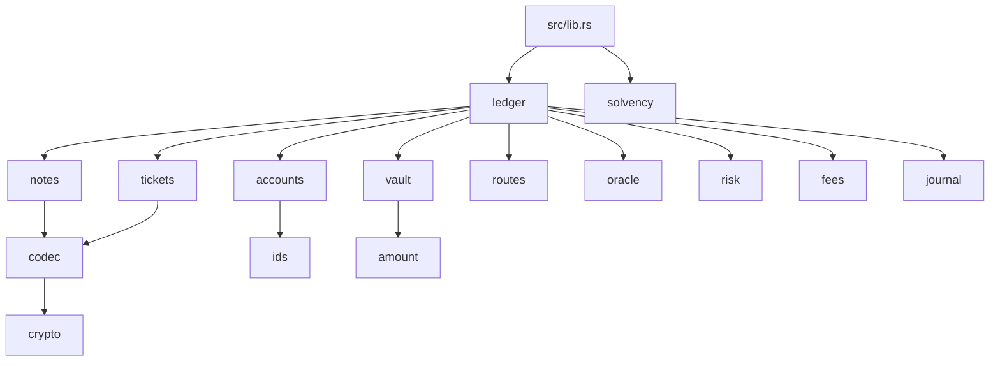
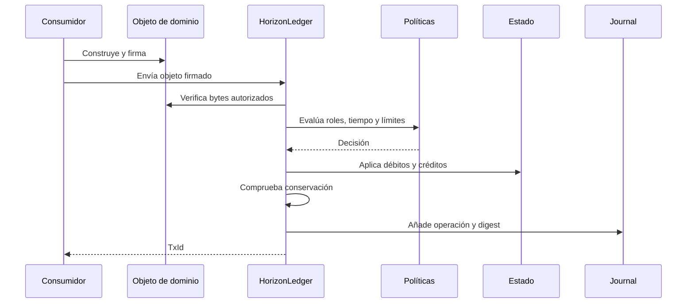
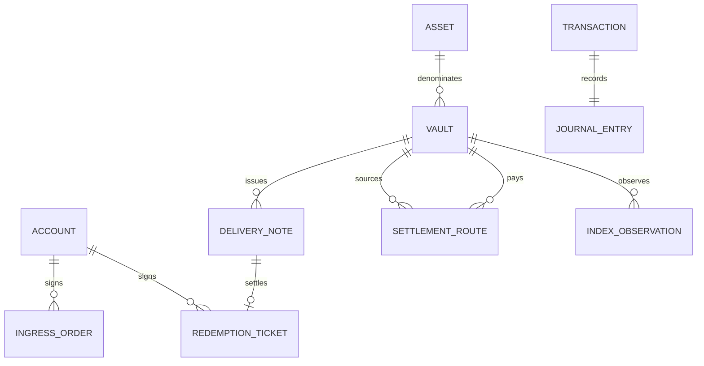

# Arquitectura de HorizonDTL

## Propósito

HorizonDTL separa autorización, política, contabilidad y evidencia. El ledger es el único
punto de mutación; los demás módulos aportan tipos de dominio y validaciones deterministas.

## Capas

| Capa         | Responsabilidad                                             |
| ------------ | ----------------------------------------------------------- |
| Contrato     | tipos exportados y compatibilidad semántica                 |
| Autorización | vista canónica, identidad, firma, nonce y epoch             |
| Política     | roles, rutas, fees, límites y observaciones                 |
| Ejecución    | transición indivisible del ledger                           |
| Contabilidad | cuentas, reservas, notional y fee ledger                    |
| Evidencia    | operación de journal, actor, importes, referencias y digest |
| Proyección   | escenarios de cobertura y concentración sin mutar estado    |

## Frontera de mutación

La secuencia evita estados intermedios observables. Un error devuelve el estado anterior sin
avanzar nonces ni registrar la operación.

## Propiedad de los datos

Los identificadores son valores derivados y no contadores globales. Esto hace que una misma
entrada produzca la misma identidad lógica y permite detectar duplicados antes de la mutación.

## Serialización y digests

`codec::canonical_bytes` es el formato común para firmas y digests. Los campos se ordenan por
estructura, no por el orden de un mapa externo. Los consumidores deben reutilizar las vistas
de autorización exportadas en vez de reconstruir mensajes de firma manualmente.

## Compatibilidad

La API pública se concentra en `src/lib.rs`. Los módulos internos pueden evolucionar sin
afectar consumidores mientras se conserven tipos, validaciones y semántica documentada. Un
cambio incompatible requiere nueva versión mayor y migración explícita.
