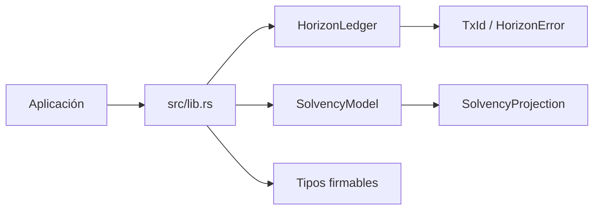
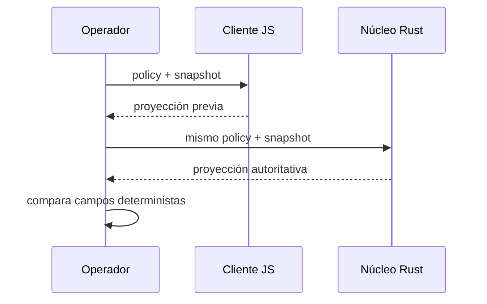
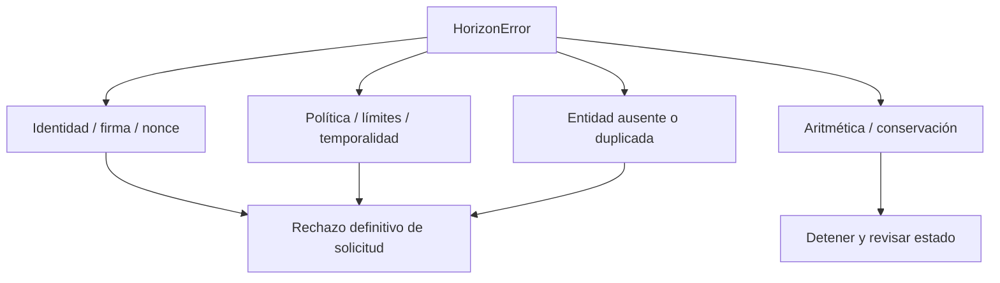

# Integración y cliente

## Contrato Rust

El consumidor importa únicamente tipos reexportados por `horizon_dtl`. La construcción de
objetos puede ocurrir fuera del proceso, pero la validación y mutación pertenecen al ledger.



## Cliente JavaScript

`client/horizon.js` implementa la proyección de solvencia con `BigInt`. Acepta cadenas o
enteros compatibles y devuelve un objeto congelado cuyas magnitudes son cadenas decimales.



No conviertas importes a `Number`; valores superiores a `2^53 - 1` pierden precisión.

## Ejemplo completo

```javascript
const { projectSolvency } = require("../client/horizon");

const projection = projectSolvency(
    {
        reserveShockBps: 750,
        sourceRecoveryBps: 7000,
        backstopRecoveryBps: 4000,
        queuedCoverageBps: 9000,
        targetBufferBps: 1500,
        maxRouteConcentrationBps: 4500,
        reserveFloor: "5000000000",
    },
    {
        payoutReserve: "90000000000",
        sourceReserve: "25000000000",
        liveRoutedLiability: "60000000000",
        queuedLocalLiability: "7000000000",
        queuedRoutedLiability: "8000000000",
        backstopCapacity: "15000000000",
        largestRouteLiability: "22000000000",
    },
);

if (projection.band !== "normal") {
    console.log("review required", projection);
}
```

## Adaptación de errores



No reintentes automáticamente un error determinista con la misma entrada. Un reintento solo
tiene sentido después de obtener nonce, epoch, configuración o snapshot actualizados.

## Paridad

La paridad entre implementaciones se comprueba con vectores que incluyen:

- proyección `normal` con buffer;
- shortfall y banda `critical`;
- concentración y banda `restricted`;
- valores negativos y basis points fuera de rango;
- inconsistencia entre mayor ruta y total de obligaciones;
- magnitudes superiores al rango seguro de JavaScript `Number`.

Rust es la referencia para una transición. El cliente JavaScript sirve para prevalidación,
interfaces operativas y comparación de snapshots.
