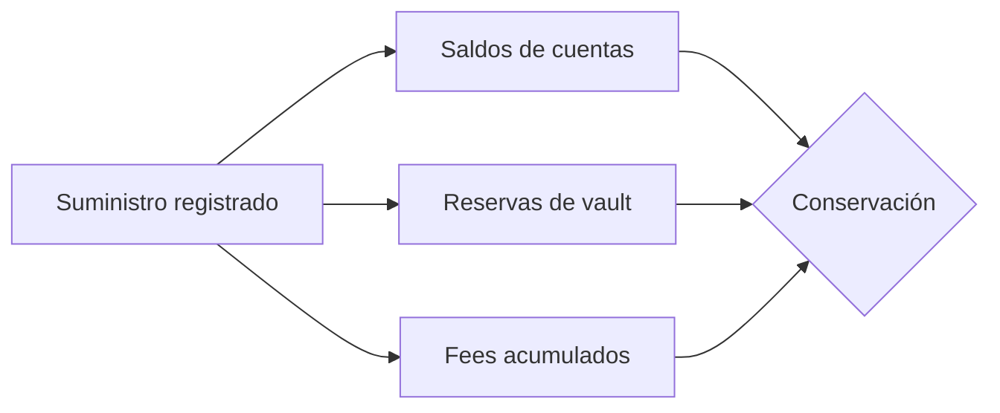
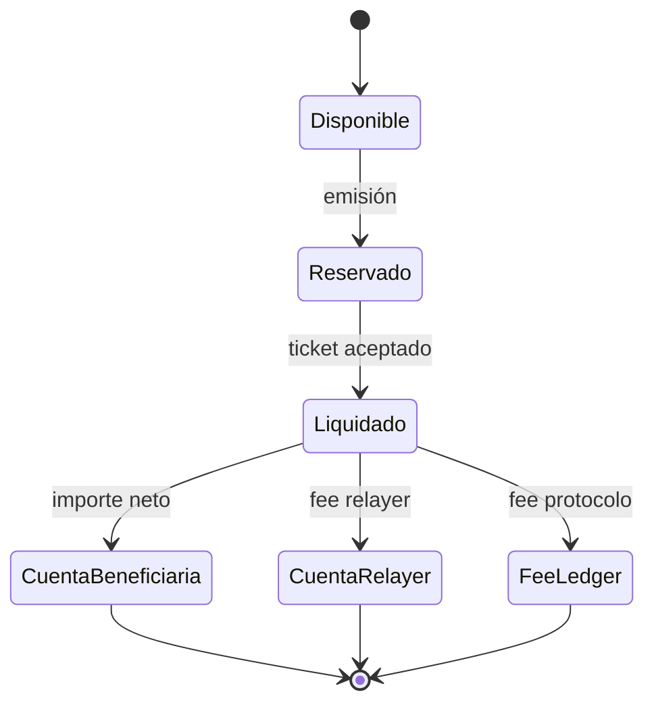
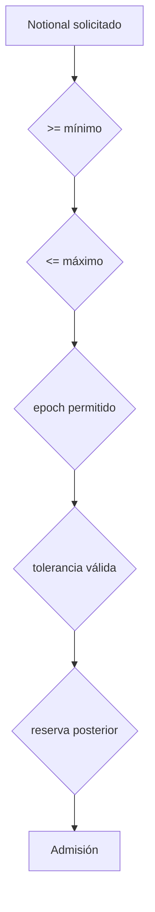

# Modelo económico

## Unidades

Cada `Amount` representa unidades mínimas del activo. `Bps` usa una escala de `10.000` y
`ShareIndex` una escala de `10^12`. No se usa coma flotante.

```text
fee = floor(amount × fee_bps / 10_000)
share_units = floor(amount × 10^12 / share_index)
indexed_amount = floor(share_units × share_index / 10^12)
```

El redondeo hacia abajo es uniforme. Las sumas, restas y multiplicaciones se ejecutan con
operaciones comprobadas.

## Dominios contables



La reconciliación por activo se expresa como:

```text
registered_supply = account_balances + vault_reserves + accrued_fees
```

El notional comprometido es una métrica de obligación y no se suma de nuevo al suministro.

## Ciclo de valor



Una emisión mueve valor desde la cuenta del emisor a la reserva del vault. La liquidación
distribuye el valor entre beneficiario, relayer y acumulador de fees según la política activa.

## Rutas y capacidad



Una ruta identifica vault origen, vault pagador y activo. Sus límites se evalúan junto con la
política global de ticket y el suelo de reserva del vault pagador.

## Fees

El fee de protocolo y el fee del relayer cumplen funciones distintas:

- el fee de protocolo se deriva de la programación activa y se acumula por activo;
- el fee del relayer forma parte del ticket y queda limitado por la política de riesgo;
- el beneficiario recibe el importe neto después de ambos conceptos;
- el journal conserva bruto, neto y fees para una reconciliación independiente.

## Ejemplo

Para `2.500.000.000` unidades, fee de protocolo de `20 bps` y fee de relayer de
`5.000.000`:

```text
protocol_fee = 5.000.000
relayer_fee = 5.000.000
beneficiary_net = 2.490.000.000
distributed_total = 2.500.000.000
```

El ejemplo usa unidades mínimas; la presentación decimal depende de `AssetConfig.decimals`.
