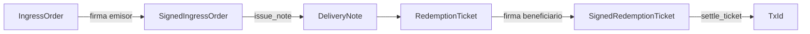
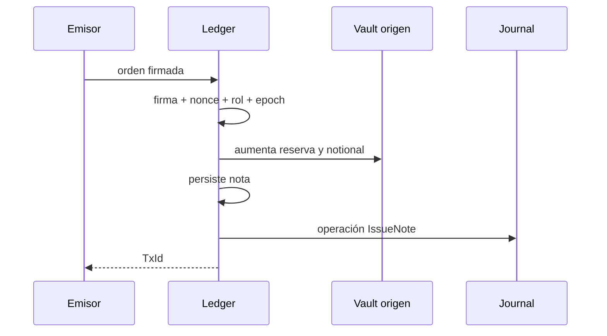
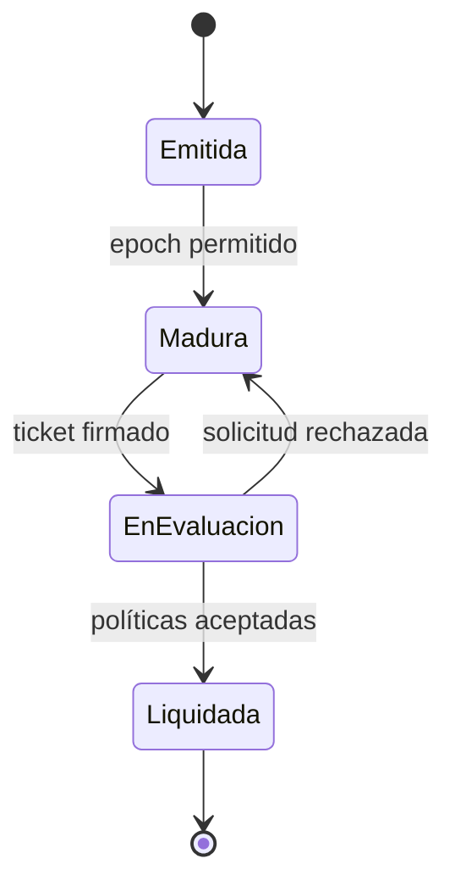

# Notas y tickets

## Separación de responsabilidades

La nota representa una obligación emitida; el ticket representa la autorización del
beneficiario para redimirla. Son objetos diferentes, con firmantes y nonces distintos.

## Emisión

La identidad de la nota se deriva de su contenido económico. El digest enlaza el ticket
posterior con la versión exacta emitida.

## Redención

La transición aceptada marca nota y ticket, distribuye importes, actualiza vaults y añade el
journal como una única operación lógica.

## Campos autorizados

| Objeto           | Campos vinculantes                                                     |
| ---------------- | ---------------------------------------------------------------------- |
| IngressOrder     | red, vault origen, emisor, beneficiario, activo, importe, nonce, epoch |
| DeliveryNote     | identidad, origen, partes, activo, importe, unidades, epoch y digest   |
| RedemptionTicket | red, vault pagador, nota, beneficiario, relayer, fee, nonce, epoch     |

Los consumidores deben obtener el nonce actual inmediatamente antes de firmar y descartar
firmas antiguas tras una operación aceptada.

## Idempotencia

La idempotencia se apoya en tres capas:

1. `ticket_id` determinista;
2. registro de tickets procesados;
3. nonce monotónico del beneficiario.

Una reentrega de red puede repetirse a nivel de transporte, pero solo una solicitud válida
puede modificar el ledger.
