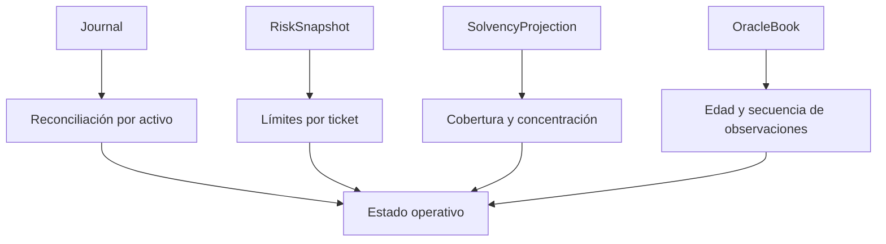
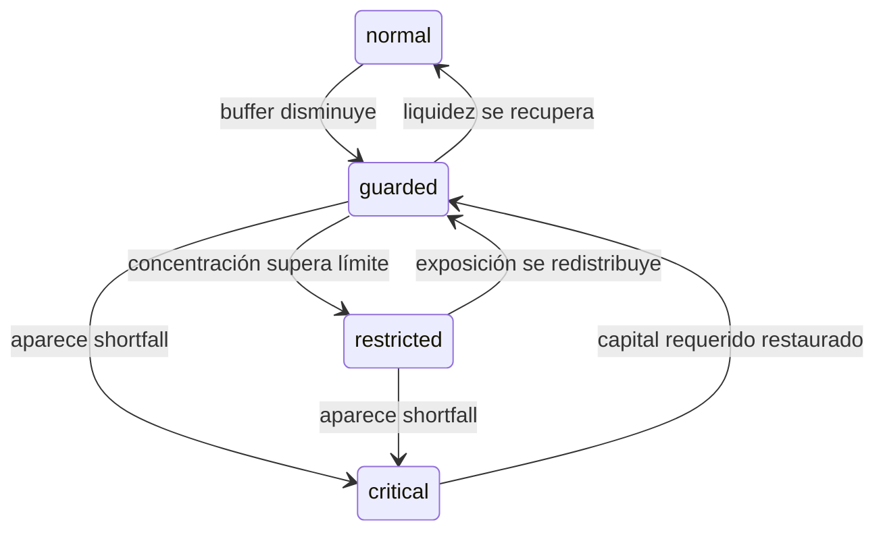

# Operación

## Preparación

La operación reproducible parte de lockfiles y toolchains declarados. No requiere servicios
externos para compilar ni ejecutar la suite.


```bash
bun install --frozen-lockfile
bun run ci
```

## Señales operativas



Métricas mínimas por epoch:

- suministro, saldos, reservas y fees por activo;
- notional activo y cantidad de notas pendientes;
- tickets aceptados y rechazados por categoría;
- reserva posterior mínima observada;
- cobertura, shortfall, buffer y concentración;
- edad de la última observación por vault;
- longitud de cola local y enrutada.

## Respuesta por banda



La transición de banda debe registrarse con inputs, política y epoch. La vuelta a una banda
menos severa requiere un snapshot nuevo; no se infiere por tiempo transcurrido.

## Runbook

1. Congelar nuevas admisiones si la banda es `critical`.
2. Conservar journal, snapshot y versión de configuración.
3. Ejecutar reconciliación por activo.
4. Comparar reservas observadas con obligaciones activas y en cola.
5. Revisar frescura del oráculo, rutas y capacidad de backstop.
6. Aplicar la corrección operativa mediante un cambio revisado.
7. Repetir proyección y suite antes de reabrir admisiones.

## Publicación estable

La rama `production`, el tag anotado `v1.0.0` y `main` deben resolver al mismo commit. El
workflow de integridad vuelve a ejecutar la cadena y comprueba las referencias antes de dar
por válido el release.

## Copias y recuperación

El crate no persiste por sí mismo. Un integrador debe persistir estado y journal de forma
atómica, conservar snapshots por epoch y verificar un digest después de restaurar. La copia
de claves privadas requiere un sistema separado con control de acceso y rotación.
