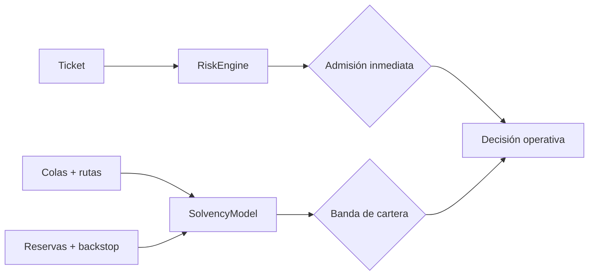
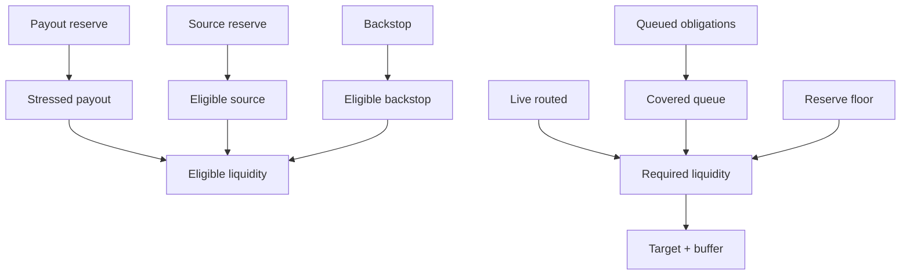
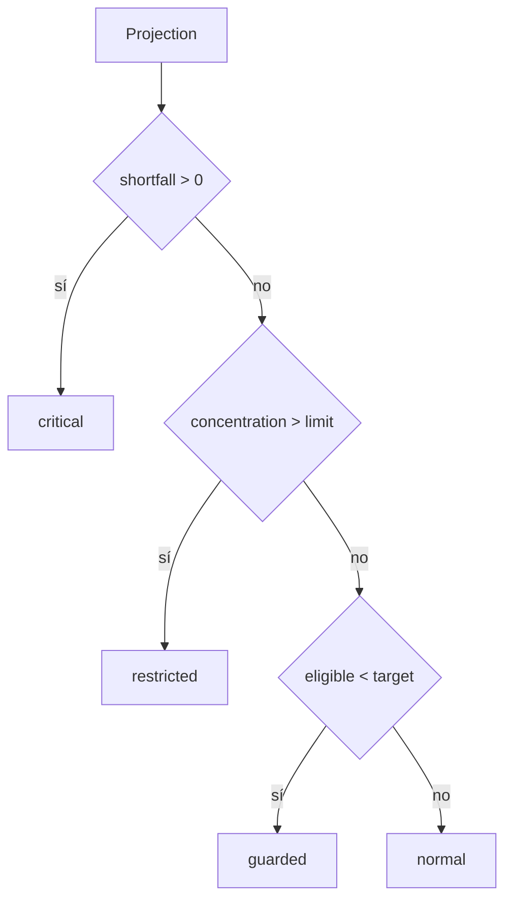

# Riesgo y solvencia

## Dos horizontes

`RiskEngine` decide si un ticket individual cumple límites inmediatos. `SolvencyModel`
proyecta el conjunto de obligaciones bajo un escenario de estrés. Ninguno sustituye al otro.



## Waterfall de liquidez

```text
stressed_payout = floor(payout_reserve × (10.000 - shock_bps) / 10.000)
eligible_source = floor(source_reserve × source_recovery_bps / 10.000)
eligible_backstop = floor(backstop × backstop_recovery_bps / 10.000)
eligible_liquidity = stressed_payout + eligible_source + eligible_backstop

covered_queue = floor((queued_local + queued_routed) × queue_coverage_bps / 10.000)
required_liquidity = live_routed + covered_queue + reserve_floor
target_liquidity = required_liquidity × (1 + target_buffer_bps / 10.000)
```



## Bandas



| Banda      | Significado                                          | Respuesta esperada                     |
| ---------- | ---------------------------------------------------- | -------------------------------------- |
| normal     | cobertura, buffer y concentración dentro de política | operación ordinaria                    |
| guarded    | cobertura suficiente, buffer inferior al objetivo    | vigilar colas y limitar crecimiento    |
| restricted | cobertura suficiente con concentración excesiva      | reducir exposición de la mayor ruta    |
| critical   | liquidez elegible inferior a la requerida            | detener admisiones y restaurar capital |

## Snapshot coherente

Todos los valores de entrada deben proceder del mismo corte lógico: epoch, versión de rutas,
últimas observaciones aceptadas y cola registrada. Mezclar cortes invalida la comparación.

## Sensibilidad

Para revisar la robustez, evalúa al menos:

- shock de reserva bajo, central y severo;
- recovery del origen degradado;
- indisponibilidad parcial del backstop;
- aumento de cola local y enrutada;
- concentración de la mayor ruta;
- incremento del suelo operativo.

La salida serializable permite almacenar escenarios sin alterar el ledger.
