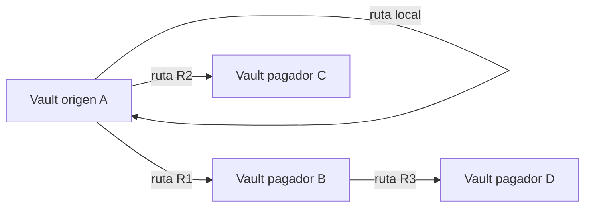
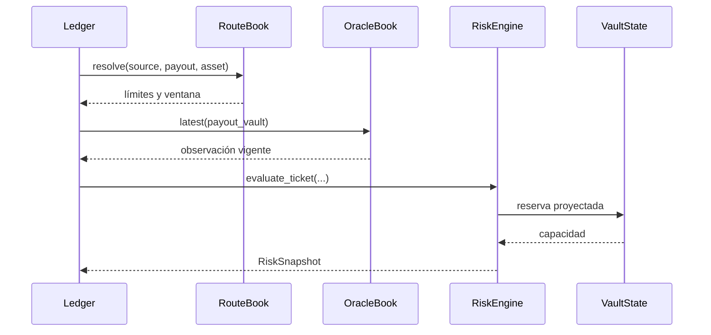
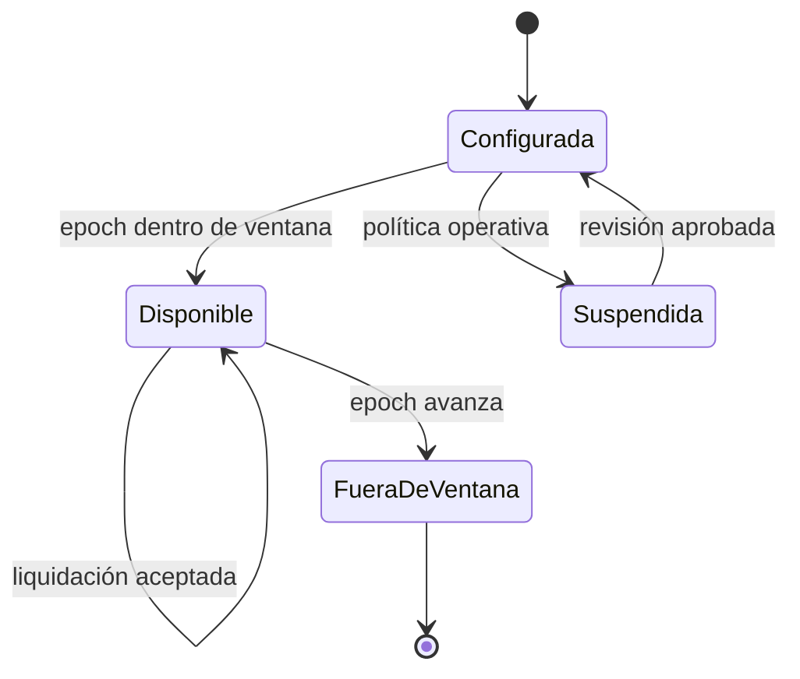

# Rutas de liquidación

## Topología

Una `SettlementRoute` autoriza un recorrido concreto entre dos vaults del mismo activo. La
existencia de una ruta no sustituye los controles de identidad, temporalidad, reserva o fee.



## Admisión



Orden recomendado de validación:

1. correspondencia de red, nota, activo y beneficiario;
2. firma, nonce y no duplicidad;
3. madurez de la nota y epoch del protocolo;
4. existencia de ruta y límites de importe;
5. observación válida para el vault pagador;
6. fee del relayer y reserva proyectada;
7. aplicación contable y journal.

## Estado de una ruta



El libro de rutas es una estructura de política. Las operaciones históricas permanecen en el
journal aunque la configuración posterior cambie.

## Concentración

La proyección de solvencia mide la mayor obligación de ruta frente al total:

```text
route_concentration_bps = floor(largest_route_liability × 10_000 / total_obligations)
```

Un exceso de concentración produce la banda `restricted` incluso cuando la liquidez requerida
está cubierta. Esto separa capacidad agregada de dependencia excesiva de un único corredor.

## Prácticas operativas

- asignar salts distintos a cada ruta;
- evitar mínimos tan bajos que generen fragmentación contable;
- dimensionar máximos con la reserva posterior, no solo con saldo actual;
- revisar concentración y cola en el mismo snapshot;
- registrar cambios de política con epoch efectivo y revisión independiente.
